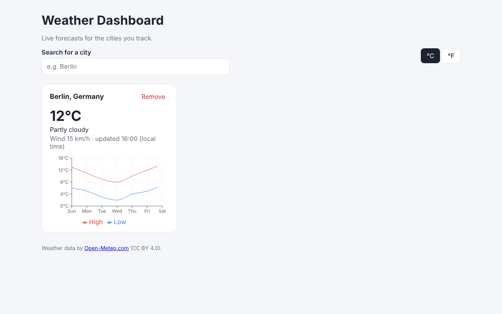

# Погодный дашборд

Адаптивный дашборд, который отслеживает погоду для любого количества городов. Найдите город, добавьте его на панель и смотрите текущие условия и график дневных максимумов и минимумов на 7 дней. Переключайте °C и °F в любой момент.

Данные приходят в реальном времени из API [Open-Meteo](https://open-meteo.com/). Ключ API не нужен.

> **Демо:** [https://kostiuchenkoav.github.io/dashboard-api-charts/](https://kostiuchenkoav.github.io/dashboard-api-charts/)



*Рис. 1. Погодный дашборд: текущие условия и график на 7 дней. На скриншоте данные Open-Meteo подставлены тестовые, так как съёмка велась без доступа в интернет. В живом демо данные реальные.*

## Возможности

- Поиск городов с отложенными запросами (debounce) и минимальной длиной запроса
- Несколько отслеживаемых городов, которые сохраняются в `localStorage` и восстанавливаются после перезагрузки
- Для каждого города: текущая температура, описание погоды и скорость ветра
- Линейный график на 7 дней (Recharts) с подсказками при наведении и таблица с теми же данными для программ чтения с экрана
- Переключатель °C / °F, который заново запрашивает данные в выбранных единицах
- Автоматическое обновление в фоне каждые 15 минут
- Состояния загрузки, пустого списка, ошибки и повторной попытки для каждого запроса
- Адаптивная сетка от мобильных экранов до десктопа
- Проверка каждого ответа API во время выполнения (zod)

## Стек технологий

| Область | Выбор | Почему |
|---|---|---|
| Интерфейс | React 18, TypeScript (строгий режим) | Типизированные компоненты и хуки |
| Сборка | Vite | Быстрый сервер разработки и компактная production-сборка |
| Серверное состояние | TanStack Query | Кэширование, дедупликация запросов, повторные попытки, фоновое обновление и отмена запросов |
| Графики | Recharts | Декларативный API для React, адаптивные контейнеры, доступные подсказки |
| Валидация | zod | Проверка ответов API во время выполнения, а не только на этапе компиляции |
| Тесты | Vitest, Testing Library, jsdom | Быстрые unit-тесты и тесты, ориентированные на пользователя |
| CI | GitHub Actions | Проверка типов, сборка и тесты на каждый push и pull request |

## Быстрый старт

Требования: Node.js 20 или новее.

```bash
npm install
npm run dev        # запуск сервера разработки на http://localhost:5173
```

### Скрипты

| Команда | Описание |
|---|---|
| `npm run dev` | Запуск сервера разработки Vite |
| `npm run build` | Проверка типов и production-сборка в папку `dist/` |
| `npm run preview` | Локальный запуск production-сборки |
| `npm run typecheck` | Проверка типов TypeScript без генерации файлов |
| `npm test` | Однократный запуск всех тестов |
| `npm run test:watch` | Запуск тестов в режиме наблюдения |

Переменные окружения и секреты не нужны.

## Архитектура

Приложение разделено на четыре слоя. Каждый слой зависит только от нижележащих.

```
components/   Интерфейс: CitySearch, CityCard, ForecastChart, UnitToggle
hooks/        Логика с состоянием, которую используют компоненты
api/          Типизированный HTTP-клиент, запросы к Open-Meteo, схемы zod
lib/          Чистые утилиты: названия погодных кодов, форматирование, хранилище, QueryClient
```

Поток данных, стратегия кэширования и подход к тестированию описаны в [docs/ARCHITECTURE.md](docs/ARCHITECTURE.md).

## Тестирование

```bash
npm test
```

В наборе 19 тестов в трёх группах:

- **Слой API** (`src/api/weather.test.ts`): параметры запросов, обработка ошибок (HTTP, сеть, некорректный ответ) и пустые результаты.
- **Чистая логика** (`src/lib/*.test.ts`): названия погодных кодов, форматирование и валидация данных localStorage, включая повреждённые данные.
- **Пользовательские сценарии** (`src/App.test.tsx`): добавление города, переключение единиц, восстановление после ошибки кнопкой «Повторить» и удаление города. Сетевые запросы подменяются через `vi.stubGlobal('fetch')`, поэтому тесты не зависят от живого API.

## Доступность

- У каждого поля есть подпись: видимая или скрытая для визуального отображения.
- Переключатели и фильтры передают состояние через `aria-pressed`.
- Сообщения о загрузке и ошибках используют `role="status"` и `role="alert"`.
- У каждого графика есть `figcaption` и скрытая таблица с теми же значениями.
- У элементов есть видимый фокус для навигации с клавиатуры.

## Решения по производительности

- **Отложенный поиск.** Ввод «Берлин» отправляет один запрос геокодинга, а не шесть.
- **Ленивая загрузка графика.** Recharts (около 386 kB в минифицированном виде) загружается только когда карточка города отображает прогноз, поэтому первый экран остаётся лёгким. Основной бандл занимает около 243 kB.
- **Кэширование запросов.** Данные считаются свежими пять минут. При смене единиц перезапрашиваются только нужные карточки, а для каждой единицы хранится отдельная запись в кэше.
- **Отмена запросов.** Запросы получают `AbortSignal`, поэтому устаревшие поиски отменяются при изменении запроса.

## Структура проекта

```
src/
  api/
    client.ts          fetchJson() с обработкой ошибок и проверкой ответа
    schemas.ts         Схемы zod и выведенные из них типы ответов API
    weather.ts         searchCities() и fetchForecast()
  components/
    CitySearch.tsx     Поле поиска, отложенный геокодинг, список результатов
    CityCard.tsx       Запрос прогноза и состояния карточки одного города
    ForecastChart.tsx  Линейный график Recharts и доступная таблица
    UnitToggle.tsx     Переключатель °C / °F
  hooks/
    useDebouncedValue.ts
    useFavoriteCities.ts
  lib/
    favorites.ts       Сохранение городов в localStorage с валидацией
    format.ts          Форматирование температуры, дней недели и названий городов
    queryClient.ts     Общая настройка TanStack Query
    weatherCodes.ts    Названия кодов погоды WMO
  test/                Настройка тестов, фикстуры и вспомогательный render
docs/
  API.md               Справочник по внешнему API
  ARCHITECTURE.md      Архитектурные решения
```

## Источник данных и атрибуция

Данные о погоде предоставлены [Open-Meteo.com](https://open-meteo.com/) по лицензии [CC BY 4.0](https://creativecommons.org/licenses/by/4.0/). Атрибуция выводится в подвале приложения. Бесплатный тариф Open-Meteo предназначен для некоммерческого использования, поэтому перед коммерческим запуском проверьте условия. Подробности в [docs/API.md](docs/API.md).

## Известные ограничения

- Прогноз Open-Meteo в приложении охватывает 7 дней, а график показывает только дневные значения.
- Отслеживаемые города хранятся в браузере. Аккаунтов и синхронизации с сервером нет.
- Поиск возвращает не более 5 совпадений.

## Планы развития

- Почасовой прогноз для выбранного дня
- Изменение порядка карточек перетаскиванием
- Тёмная тема с учётом системных настроек

## Участие в проекте

Issues и pull request приветствуются. Перед отправкой прочитайте [CONTRIBUTING.md](CONTRIBUTING.md).

## Лицензия

[MIT](LICENSE)
